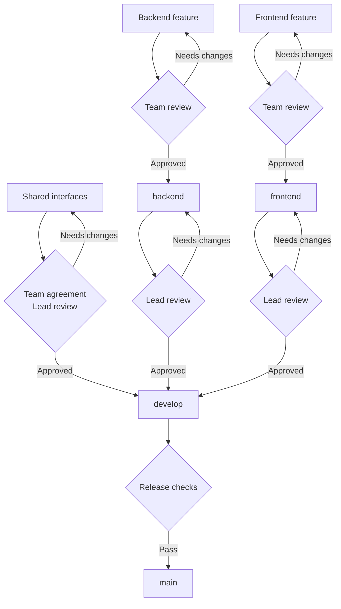
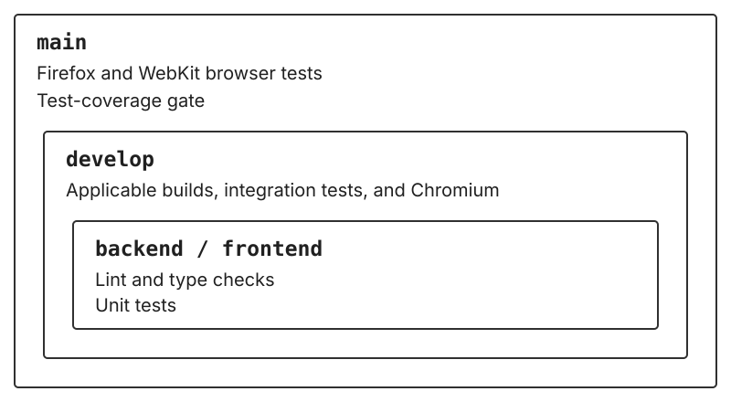

# Contributing

[Set up the local development tools](README.md#local-development) to preview and check your changes before submitting them for review.

For normal feature work, follow [Feature work](#feature-work) below. If you need to define or change shared frontend/backend interfaces, see [Adding or changing a shared interface](#adding-or-changing-a-shared-interface).

## Feature work

We use `backend` and `frontend` as long-lived trunk branches where each area combines its reviewed feature work before merging into `develop`. Create your feature branch from the trunk for your area.

Run `npm run check` and `npm run test:unit`, then open a PR back to your trunk for team review. Work with QA on testing the behavior your feature introduces. The [test instructions](README.md#tests) cover running the integration and browser suites locally when you need to check the combined app.

## Adding or changing a shared interface

If your feature needs a new shared interface or a change to an existing one, propose the declaration in a separate PR to `develop`. Discuss with the team and wait for lead review before implementing the dependent feature, then bring the declaration from `develop` into your feature branch. Interface declarations take this direct path so frontend and backend can work against the same explicit contract without waiting for either implementation to be finished.

## Integration and release

[ADR-0006](docs/decisions/0006-testing-and-ci.md)

Merges from either trunk into `develop` require lead review. The leads normally review their own domains, and either can cover when needed. If review requests changes, revise the work on its branch and submit it again.

Promotion from `develop` to `main` requires CI/CD checks, including test coverage.

The merge paths above define the required reviews. Whether promotion or deployment runs automatically remains undecided.

### CI checks

[ADR-0027](docs/decisions/0027-browser-checks-by-branch.md)

Each branch runs the checks enclosed within its layer. `develop` includes the trunk checks, and `main` includes all of `develop`’s checks.

The coverage gate is not set up yet, as we still need to agree on its tool and acceptance criteria.
