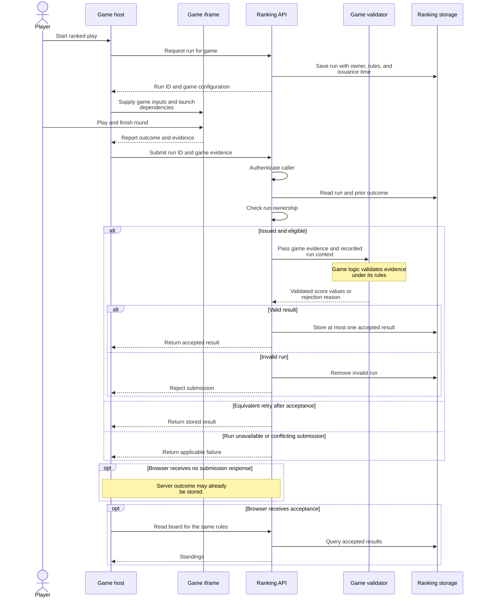

# Ranked run lifecycle

[System structure](system-structure.md) | [Ranked submission and storage](ranking-and-storage.md)

A ranked run has at most one accepted result. Submitting equivalent evidence again returns that result, including when requests arrive concurrently. This rule lets the server answer a retry without counting the same round twice.

The lifecycle below describes play started by a connected player, from run issuance into the standings. It distinguishes the result stored by the server from the confirmation received by the browser, since a lost response can leave the browser unaware of an accepted result.

For a guest attempt, the browser temporarily retains the result and run evidence. If the player chooses to enter the rankings, it keeps that evidence through account creation or connection and submits it under the connected account. The result can then enter the rankings after successful validation.

## Issuing and submitting a run

Before ranked play starts, the browser requests a run for the connected player. The server records its issuance time and the game configuration needed for validation, including the rules version. The submitted evidence is evaluated against that recorded context, so a player cannot substitute a different issuance time.

The host launches the game with its configuration and allowed dependencies. The game implements the round and reports the evidence its validator requires. On completion, the host submits the evidence automatically. The game-reported score remains provisional until the ranking server confirms acceptance.

The server checks the submitting player's identity and ownership of the run, then passes the evidence and recorded context to the game's handler for the assigned rules version. The handler interprets the evidence and returns validated scores or a rejection. The game's validation contract must establish the relationship between its evidence and the issued attempt.

## Completing the run

[ADR-0030](../decisions/0030-one-result-per-run.md)

An invalid run is disqualified from producing a ranked score. That does not require stopping the game in the browser. On submission, an invalid run is rejected and is not retained in server storage. Rejection produces no ranked result.

A valid submission can produce at most one accepted result. Concurrent equivalent submissions resolve to that same result, and an equivalent retry returns it. The server must enforce that rule atomically.

A service failure does not establish that the run is invalid.

## Acceptance with a lost response

Suppose the server accepts a submission and stores its result, but the connection drops before the response reaches the browser. The result can already count on the leaderboard. The browser, however, has no confirmation and cannot distinguish this case from a request that never reached the server.

If the server later receives equivalent evidence for the same run, it returns the stored result.

Until confirmation reaches the browser, the player has no confirmed outcome. The interface must not present that uncertainty as rejection. The recovery flow remains undecided, including how the player sees this condition and whether the browser retains submissions for automatic retries.

## Reading the leaderboard

After acceptance, the browser can query standings for the same game and rules. The query uses accepted results under the board's comparison rule. Acceptance need not change the player's rank if an earlier result is better.

The [player result flow](../player-flows/play-and-results.md#reading-the-result) covers presentation.
