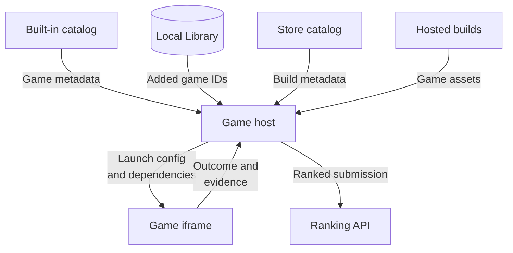
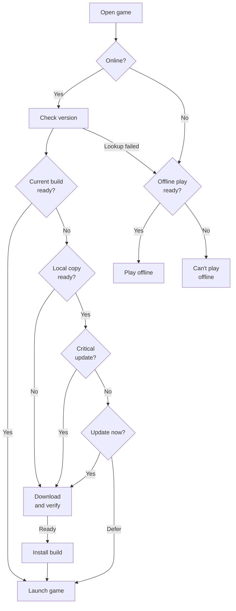
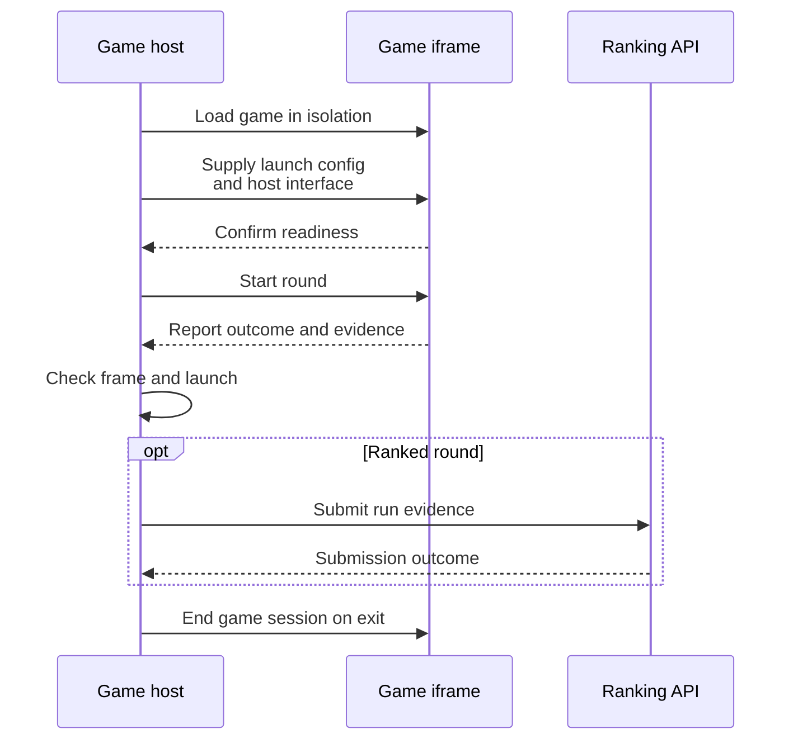
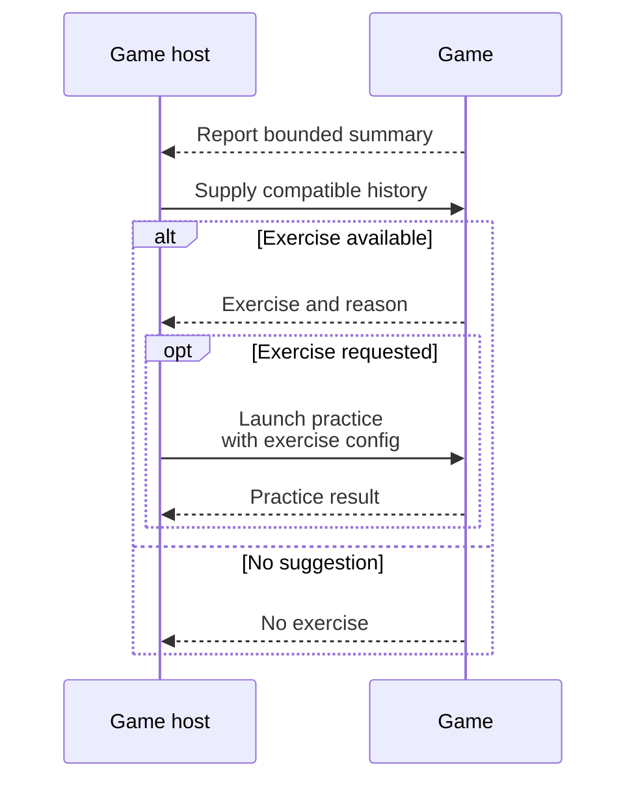

# Game runtime and local Library

[System structure](system-structure.md)

The app launches every game through an iframe host that provides its allowed dependencies and receives the round outcome. The game supplies its own interface and mechanics. This boundary lets the app launch both built-in and added games without implementing their rules in the host.

We retain and distribute published game builds through infrastructure we control. The host downloads the assets needed for play and exchanges data with the game through its injected interface.

## Game identity and versions

A stable game ID keeps Library entries and earlier results attached to a game when its title changes. The installed build is tracked separately from the ranked rules version: a cosmetic update can preserve score comparability, while a scoring change needs a distinct rules version and matching game-provided validation handler.

Results and practice summaries must remain associated with the same game across updates. Games define which historical summaries their practice hooks can interpret, and the host supplies compatible history.

The [Store flow](../player-flows/store.md#browsing-and-narrowing-the-catalog) describes the information players need to discover a game. The [Library flow](../player-flows/library.md) covers organizing added games independently of whether their assets have been downloaded.

## Install and update lifecycle

[ADR-0032](../decisions/0032-host-published-game-builds.md) [ADR-0028](../decisions/0028-update-games-on-online-open.md)

The local Library stores membership independently of downloaded assets and is available without account connection. Adding a game creates its entry immediately; an absent or failed download leaves that entry intact. The catalog supplies account requirements and published-build metadata, while the host tracks local asset availability. Published versions have fixed contents, so an update creates a new build version.

The host requires the necessary assets before launch. Completing a download changes installation state without creating or replacing Library membership. A partial update leaves any existing installation intact, so a failed replacement cannot destroy the last complete copy.

On an online open, the host resolves the game's current published build and the author's critical-update classification. It applies critical updates before online play. A deferred non-critical update permits launching a complete installed copy. The [Library flow](../player-flows/library.md#launching-a-game) describes the player's update controls.

When an update proceeds, the host fetches and verifies the replacement. Once it is ready, the host updates the recorded installed version while retaining the game ID and associated history. The ranking server enforces [version eligibility and score revocation](ranking-and-storage.md#validation-pipeline) independently of the installed build.

If the update check fails or the browser is offline, the host can launch a complete installed copy of an offline-capable game with ranking and other online features disabled. The next online open checks for updates again. Background downloading and prefetching follow the saved preference, which defaults to enabled. Deferring an update does not change that preference.

The launch path below uses the installed copy when an update is deferred or the game can run offline. **Offline play ready?** requires both game support and a complete local copy of its assets.

Removing a Library entry also deletes its owned package assets and preserves score history.

## Runtime interface

[ADR-0017](../decisions/0017-iframe-game-runtime.md)

Once a build is ready to launch, the host loads its entry point in an iframe. The frame handles the player's input and draws its own interface; the host passes in the launch configuration and provides a way to report readiness and the outcome. The game confirms readiness before the host starts the round. The communication mechanism remains open, and the interface does not require all communication to use one channel.

Guest rounds use the same iframe interface and initially return unranked scores. The host retains their result and evidence in temporary browser state through account connection, allowing later authenticated submission of the same attempt. The [run lifecycle](event-model.md) covers that submission.

Creator previews and reviewer launches use the same host as player launches so that admission tests the actual integration.

The host must associate communication with the correct game launch and reject messages from another frame or an earlier round.

The frame receives only the capabilities and data needed for that launch. AT credentials stay in the host. For a ranked round, a game-reported score remains provisional until the ranking server accepts it.

Hosting the builds gives us control over their distribution, but the iframe's serving origin and sandbox policy remain undecided. Network access and response policies also need review so game scripts remain isolated from the app's credentials and browser storage. The [iframe sandbox](https://html.spec.whatwg.org/multipage/iframe-embed-object.html#attr-iframe-sandbox) provides browser controls for that boundary.

### Scoped practice hooks

[ADR-0013](../decisions/0013-scoped-practice-hooks.md)

Games can report a round summary alongside the result. The host stores those summaries and supplies compatible history to an optional practice hook. The game interprets the summaries and returns an exercise with a reason, or no suggestion. Exercise selection and mechanics belong to the game; history access belongs to the host.

A summary is game-defined and bounded, with enough version information for the host to return compatible history. The host supplies only a limited set for the current player and game. This keeps the game from needing direct access to account-wide storage while leaving interpretation with the component that understands the mechanics.

The host passes a requested exercise back to the game as practice launch configuration. Ordinary practice remains available if history is insufficient, the hook fails, or the game has no hook. The [practice flow](../player-flows/play-and-results.md#scoped-practice) covers how suggestions are presented and chosen.
