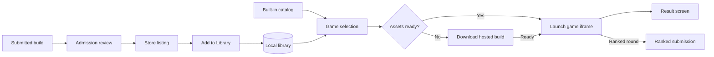
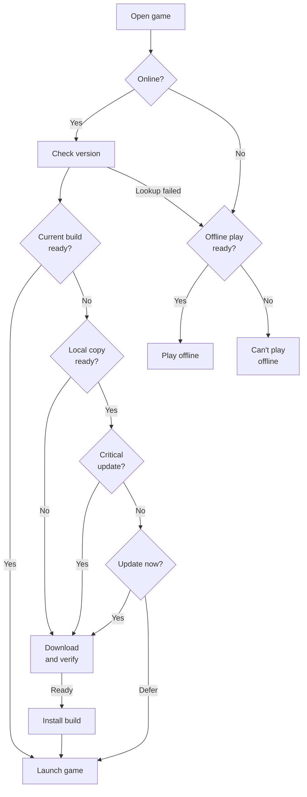
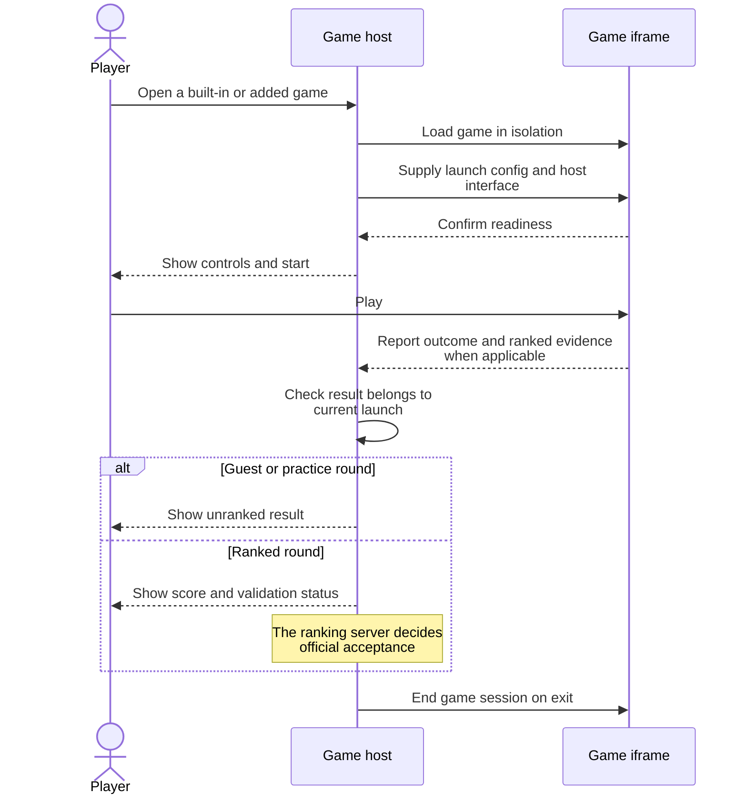
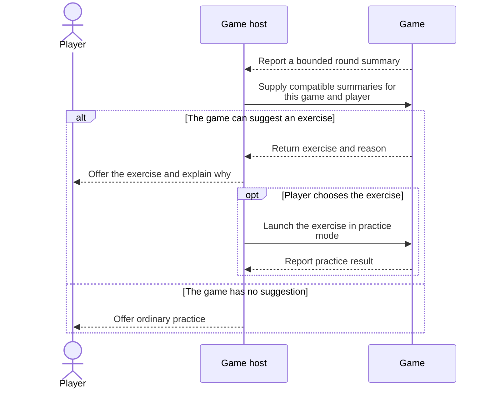

# Game runtime and local Library

[System structure](system-structure.md)

The app launches every game through an iframe host that provides its allowed dependencies and receives the round outcome. The game supplies its own interface and mechanics. This boundary lets the app launch both built-in and added games without implementing their rules in the host.

We retain and distribute published game builds through infrastructure we control. The host downloads the assets needed for play and exchanges data with the game through its injected interface.

## Game identity and versions

A stable game ID keeps Library entries and earlier results attached to a game when its title changes. The installed build is tracked separately from the ranked rules version: a cosmetic update can preserve score comparability, while a scoring change needs a distinct rules version and matching game-provided validation handler.

Results and practice summaries must remain associated with the same game across updates. Games define which historical summaries their practice hooks can interpret, and the host supplies compatible history.

The [Store flow](../player-flows/store.md#browsing-and-narrowing-the-catalog) describes the information players need to discover a game. The [Library flow](../player-flows/library.md) covers organizing added games independently of whether their assets have been downloaded.

## Install and update lifecycle

[ADR-0032](../decisions/0032-host-published-game-builds.md) [ADR-0028](../decisions/0028-update-games-on-online-open.md)

Guests and connected players use the local Library. Guests can download and play games that do not require an account, with account requirements shown in the listing before download. Adding a game creates its Library entry immediately. Library membership and downloading are separate, so the entry remains available even when the game has not been downloaded or a download fails. The Store catalog identifies the published build we retain and distribute, while download status indicates whether the assets needed to play are available. Published versions have fixed contents; updates publish a new version.

Players can find and organize an added game while its download is pending. Starting play requires the necessary assets, but completing that download does not create or replace Library membership. A partial update leaves any existing installation intact, so a failed replacement cannot destroy the last complete copy.

On an online open, the host resolves the game's current published build. The author marks critical updates with a checkbox at publication. A critical update must be applied before online play. When the update is non-critical and a complete installed copy is available, the player can defer the download and launch that copy. This avoids making a slow connection prevent play for a routine update.

When an update proceeds, the host fetches and verifies the replacement. Once it is ready, the host updates the recorded installed version while retaining the game ID and associated history. An older version remains eligible for new ranked submissions for 24 hours after its replacement is published. The platform must support revoking scores made invalid by a game-breaking bug; the ordinary version window leaves valid historical results intact.

If the update check fails, the player can use the installed copy without ranking or other online features, provided the game supports offline play and its required assets are present. The same fallback applies while offline. The next online open checks for updates again. Background downloads and prefetching are optional and enabled by default. The host follows that preference independently of whether the player defers a non-critical update.

The launch path below uses the installed copy when an update is deferred or the game can run offline. **Offline play ready?** requires both game support and a complete local copy of its assets.

When the player removes a game, the app deletes its Library entry and owned package assets while preserving score history.

## Runtime interface

[ADR-0017](../decisions/0017-iframe-game-runtime.md)

Once a build is ready to launch, the host loads its entry point in an iframe. The frame handles the player's input and draws its own interface; the host passes in the launch configuration and provides a way to report readiness and the outcome. The game confirms readiness before the host starts the round. The communication mechanism remains open, and the interface does not require all communication to use one channel.

Guest rounds use the same iframe host and initially return unranked scores. The browser temporarily keeps the result and run evidence so a guest can create or connect an account and submit that evidence under the connected account. The result may enter the rankings if validation succeeds.

Creator previews and reviewer launches use the same host as player launches so that admission tests the actual integration.

The host must associate communication with the correct game launch and reject messages from another frame or an earlier round.

The frame receives only the capabilities and data needed for that launch. AT credentials stay in the host. For a ranked round, a game-reported score remains provisional until the ranking server accepts it.

Hosting the builds gives us control over their distribution, but the iframe's serving origin and sandbox policy remain undecided. Network access and response policies also need review so game scripts remain isolated from the app's credentials and browser storage. The [iframe sandbox](https://html.spec.whatwg.org/multipage/iframe-embed-object.html#attr-iframe-sandbox) provides browser controls for that boundary.

### Scoped practice hooks

[ADR-0013](../decisions/0013-scoped-practice-hooks.md)

After a round, the game can report a summary as well as its result. Optional practice hooks use these summaries to recommend an exercise for a difficulty seen in the player's recent attempts. The host stores the summaries and passes compatible ones to the game. The game defines useful summaries and interprets them because it knows which exercises address which mistakes. The host shows the exercise and the game's reason before the player chooses it.

A summary is game-defined and bounded, with enough version information for the host to return compatible history. The host supplies only a limited set for the current player and game. This keeps the game from needing direct access to account-wide storage while leaving interpretation with the component that understands the mechanics.

The hook may return an exercise and a reason, or no suggestion. If the player chooses the exercise, the host passes it back as practice launch configuration. Ordinary practice remains available when history is insufficient, the hook fails, or the game has no hook. The game defines its summary and exercise data. The host enforces compatibility and bounded history access. The [practice flow](../player-flows/play-and-results.md#scoped-practice) covers the player's choice.
