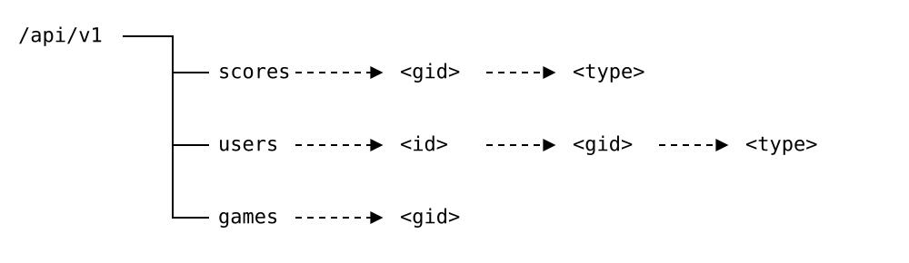

# HTTP API

The frontend submits scores and retrieves standings through the HTTP API. The API also provides access to user and game records.

## Routes


`<id>`, `<gid>`, and `<type>` are placeholders for a user ID, game ID, and game-defined score type. Dashed arrows lead to optional segments. A request must include every segment leading to its endpoint.

| Route | GET | POST | PUT | PATCH | DELETE |
| --- | --- | --- | --- | --- | --- |
| `/scores[/<gid>]` | Yes | - | - | - | - |
| `/scores/<gid>/<type>` | Yes | Yes | - | - | Yes |
| `/users[/<id>]` | Yes | Yes | - | Yes | Yes |
| `/users/<id>/<gid>` | Yes | Yes | - | - | Yes |
| `/users/<id>/<gid>/<type>` | Yes | - | - | - | Yes |
| `/games[/<gid>]` | Yes | Yes | - | - | Yes |

## Score endpoints

[ADR-0015](../decisions/0015-multiple-scores-per-game.md)

Note that wherever I say "Response", this is the *expected* response.

11/24/2026: In order to make translating the existing API simpler, error types are not yet defined. NVPTODO: Define after MVP

### `GET /api/v1/scores`

- Query: [ScoreLookupQuery](../../src/shared/http-api.ts).
- Response: `200 OK` with [Score](../../src/shared/scores.ts).

Returns the score identified by `sid`. Returns `404 Not Found` if that score does not exist.

Query parameters:

- `sid`: Required server-assigned integer score ID.

```sh
curl 'http://127.0.0.1:3000/api/v1/scores?sid=123'
```

### `GET /api/v1/scores/<gid>`

- Path: [GamePath](../../src/shared/http-api.ts).
- Query: [LeaderboardQueryParameters](../../src/shared/http-api.ts).
- Response: `200 OK` with [GameLeaderboardsResponse](../../src/shared/http-api.ts).

Returns standings keyed by score type so the frontend can preload them. Each type's standings contain one entry per player, using their best score for the requested game instance. The game's comparison function orders each set from best to worst, with ties in either order. Entries contain the score and user record.

Query parameters:

- `gameInfo`: Game instance to retrieve scores for. Sudoku uses its puzzle date in `YYYY-MM-DD` format.
- `start`: Zero-based index of the first entry in each type's standings, inclusive.
- `end`: Index at which to stop in each type's standings, exclusive.

Both indices must be non-negative integers with `start <= end`. The range applies separately to each type after filtering and ranking. A type with fewer matching entries returns only those available within the range.

For example, this request retrieves up to ten entries per score type for a Sudoku puzzle from the local server.

```sh
curl 'http://127.0.0.1:3000/api/v1/scores/sudoku?gameInfo=2026-11-24&start=0&end=10'
```

### `GET /api/v1/scores/<gid>/<type>`

- Path: [GameScoreTypePath](../../src/shared/http-api.ts).
- Query: [LeaderboardQueryParameters](../../src/shared/http-api.ts).
- Response: `200 OK` with [LeaderboardResponse](../../src/shared/scores.ts).

Returns `LeaderboardResponse` (`LeaderboardEntry[]`) for the specified game and score type. Each player appears once, with their best score for the requested game instance. The game's comparison function orders entries from best to worst, with ties in either order. Each entry contains the score and user record.

Query parameters:

- `gameInfo`: Game instance to retrieve scores for. Sudoku uses its puzzle date in `YYYY-MM-DD` format.
- `start`: Zero-based index of the first entry, inclusive.
- `end`: Index at which to stop, exclusive.

Both indices must be non-negative integers with `start <= end`. The range applies after filtering and ranking, and returns fewer entries if the leaderboard ends before `end`.

### `POST /api/v1/scores/<gid>/<type>`

- Path: [GameScoreTypePath](../../src/shared/http-api.ts).
- Body: [SubmitScoreBody](../../src/shared/http-api.ts).
- Response: `201 Created` with the stored [Score](../../src/shared/scores.ts), including its assigned `sid`.
- `Location`: `/api/v1/scores?sid=<sid>`.

Submits one score for the specified game and score type. The body contains `userId`, `value`, and `gameInfo`. The server assigns `sid` and the submission timestamp and stores the attempt alongside earlier attempts.

### `DELETE /api/v1/scores/<gid>/<type>`

- Path: [GameScoreTypePath](../../src/shared/http-api.ts).
- Query: [ScoreLookupQuery](../../src/shared/http-api.ts).
- Response: `204 No Content`, with no response body.

Deletes the score identified by `sid`. The score must belong to the game and score type in the path, and the caller must have permission to delete its owner's score.

Query parameters:

- `sid`: Required server-assigned integer score ID.

## User endpoints

### `GET /api/v1/users`

- Query: [PaginationQuery](../../src/shared/pagination.ts).
- Response: `200 OK` with [UserListResponse](../../src/shared/http-api.ts).

Returns `User[]`, containing the requested page of users.

Query parameters:

- `start`: Zero-based index of the first entry, inclusive.
- `end`: Index at which to stop, exclusive.

Both indices must be non-negative integers with `start <= end`. The range applies after filtering and ordering, and returns fewer entries if the collection ends before `end`.

### `POST /api/v1/users`

- Body: [CreateUserBody](../../src/shared/http-api.ts).
- Response: `201 Created` with [User](../../src/shared/scores.ts).
- `Location`: `/api/v1/users/<id>`.

Creates a user record.

### `GET /api/v1/users/<id>`

- Path: [UserPath](../../src/shared/http-api.ts).
- Response: `200 OK` with [User](../../src/shared/scores.ts).

Returns the specified user's record as `User`.

### `PATCH /api/v1/users/<id>`

- Path: [UserPath](../../src/shared/http-api.ts).
- Body: [UpdateUserBody](../../src/shared/http-api.ts).
- Response: `200 OK` with the updated [User](../../src/shared/scores.ts).

Updates the supplied user fields. Requires permission to modify that user's data.

### `DELETE /api/v1/users/<id>`

- Path: [UserPath](../../src/shared/http-api.ts).
- Response: `204 No Content`, with no response body.

Deletes the specified user record. Requires permission to delete that user's data.

### `GET /api/v1/users/<id>/<gid>`

- Path: [UserGamePath](../../src/shared/http-api.ts).
- Query: [PaginationQuery](../../src/shared/pagination.ts).
- Response: `200 OK` with [UserScoresResponse](../../src/shared/http-api.ts).

Returns `Score[]`, containing the requested page of the player's scores for the game.

Query parameters:

- `start`: Zero-based index of the first entry, inclusive.
- `end`: Index at which to stop, exclusive.

Both indices must be non-negative integers with `start <= end`. The range applies after filtering and ordering, and returns fewer entries if the collection ends before `end`.

### `POST /api/v1/users/<id>/<gid>`

- Path: [UserGamePath](../../src/shared/http-api.ts).
- Body: [SubmitUserScoreBody](../../src/shared/http-api.ts).
- Response: `201 Created` with the stored [Score](../../src/shared/scores.ts), including its assigned `sid`.
- `Location`: `/api/v1/scores?sid=<sid>`.

Submits one score for the specified player and game. The body contains `type`, `value`, and `gameInfo`. The server assigns `sid` and the submission timestamp and preserves earlier attempts.

### `DELETE /api/v1/users/<id>/<gid>`

- Path: [UserGamePath](../../src/shared/http-api.ts).
- Query: [ScoreLookupQuery](../../src/shared/http-api.ts).
- Response: `204 No Content`, with no response body.

Deletes the score identified by `sid`. The score must belong to the player and game in the path, and the caller must have permission to delete that player's score.

Query parameters:

- `sid`: Required server-assigned integer score ID.

### `GET /api/v1/users/<id>/<gid>/<type>`

- Path: [UserGameScoreTypePath](../../src/shared/http-api.ts).
- Query: [PaginationQuery](../../src/shared/pagination.ts).
- Response: `200 OK` with [UserScoresResponse](../../src/shared/http-api.ts).

Returns `Score[]`, containing the requested page of the player's scores for the game and score type.

Query parameters:

- `start`: Zero-based index of the first entry, inclusive.
- `end`: Index at which to stop, exclusive.

Both indices must be non-negative integers with `start <= end`. The range applies after filtering and ordering, and returns fewer entries if the collection ends before `end`.

### `DELETE /api/v1/users/<id>/<gid>/<type>`

- Path: [UserGameScoreTypePath](../../src/shared/http-api.ts).
- Query: [ScoreLookupQuery](../../src/shared/http-api.ts).
- Response: `204 No Content`, with no response body.

Deletes the score identified by `sid`. The score must belong to the player, game, and score type in the path, and the caller must have permission to delete that player's score.

Query parameters:

- `sid`: Required server-assigned integer score ID.

## Game endpoints

### `GET /api/v1/games`

- Query: [PaginationQuery](../../src/shared/pagination.ts).
- Response: `200 OK` with [GameListResponse](../../src/shared/http-api.ts).

Returns `Game[]`, containing the requested page of game records.

Query parameters:

- `start`: Zero-based index of the first entry, inclusive.
- `end`: Index at which to stop, exclusive.

Both indices must be non-negative integers with `start <= end`. The range applies after filtering and ordering, and returns fewer entries if the collection ends before `end`.

### `POST /api/v1/games`

- Body: [CreateGameBody](../../src/shared/http-api.ts).
- Response: `201 Created` with [Game](../../src/shared/games.ts).
- `Location`: `/api/v1/games/<gid>`.

Creates a game record. Restricted to developers.

### `GET /api/v1/games/<gid>`

- Path: [GamePath](../../src/shared/http-api.ts).
- Response: `200 OK` with [Game](../../src/shared/games.ts).

Returns the game record, including the entry point to load in its iframe.

- `id`: Game ID.
- `uri`: Game entry-point URI to assign to the iframe's `src`.

### `DELETE /api/v1/games/<gid>`

- Path: [GamePath](../../src/shared/http-api.ts).
- Response: `204 No Content`, with no response body.

Deletes the specified game record. Restricted to developers.

## Request validation

Error responses use [ApiError](../../src/shared/http-api.ts), with a message in the `error` field.

The HTTP layer checks the submission's structure and field types. Games define the meaning of score values and `gameInfo`. Checks that interpret those values belong to game-provided handlers, as described in the [validation boundary](ranking-and-storage.md#game-rules-and-validation-boundary).
