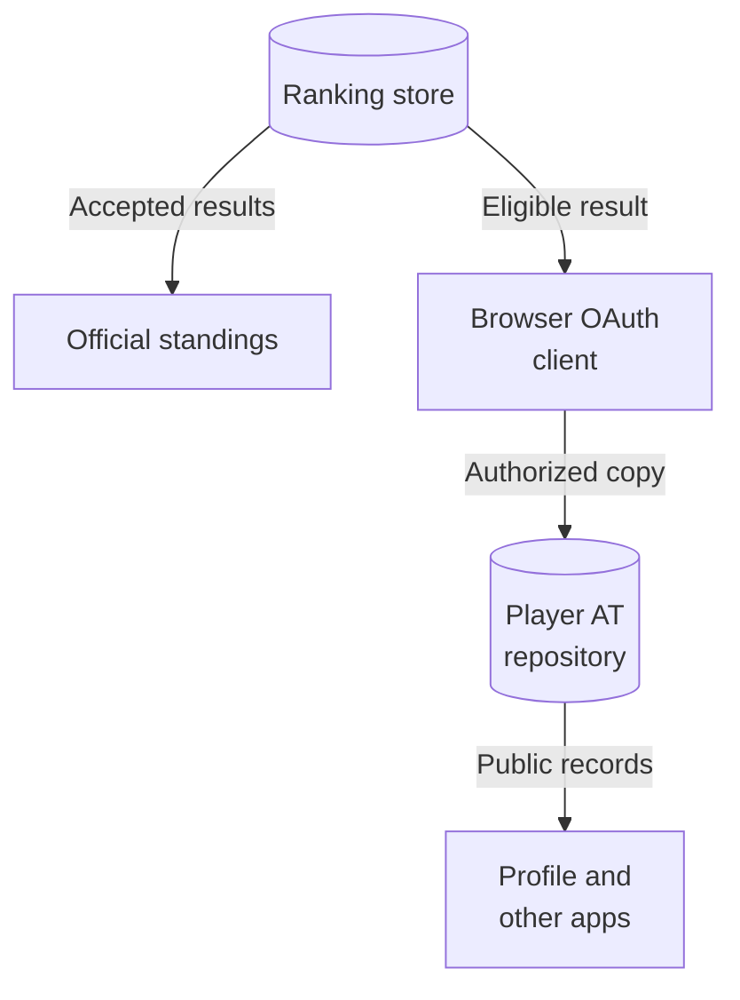

# AT Protocol identity and score sharing

[Architecture overview](README.md)

A player can send a result to friends as an achievement or a score to beat, and can publish it more widely through their AT Protocol account. Direct sharing and public publication serve different audiences and have independent controls. Official rankings remain based on the server's accepted result, so choosing an audience or deleting a public copy leaves the player's standing intact.

The integration identifies whose result is being shared and authorizes access to that player's AT repository. Browser-managed OAuth connects the account. The following sections describe ownership and visibility across direct sharing and public publication, including the outcomes required when a write or deletion fails.

## Account connection and ranked requests

[ADR-0024](../decisions/0024-browser-managed-at-oauth.md) [ADR-0023](../decisions/0023-authenticate-ranked-requests-with-at-tokens.md)

Ranked requests and social operations require a connected account. Browsing and local Library operations are available without one.

- **Handle:** A human-readable account name used for sign-in, discovery, and display. Handles can change.
- **DID:** The stable AT account identifier obtained through OAuth. The ranking server requires verified proof of that identity when authenticating a request.
- **AT Protocol credentials:** Authorize scoped access to the player's PDS. The browser's OAuth client holds them outside game frames.
- **AT service token:** Carries identity proof for a ranked request. The browser sends a token addressed to the ranking API, which verifies it directly instead of issuing a separate app-managed session.
- **AT URI and CID:** Identify a public record and a particular version of it. They serve as share or publication references; they do not prove that the ranking server accepted the score.

## Direct score sharing

[ADR-0014](../decisions/0014-score-sharing-and-challenges.md)

Direct sharing identifies the sender, intended recipients, and accepted result independently of public AT publication. Ordinary shares and challenges use the same protocol object. A challenge flag distinguishes an invitation to beat the score from a share sent only for viewing; the frontend uses that flag to determine the actions available to the recipient.

The [Friends flow](../player-flows/friends.md) shows how a mutual request leads to an exchange.

## Public AT records

[ADR-0008](../decisions/0008-at-protocol-identity-and-publication.md)

The browser's OAuth client writes an eligible result to the player's repository. Official standings read the ranking server's accepted results, while public profiles and compatible apps read the published copies.

Publication requires the player's write authorization and applies their publication preference to the selected result. Ranking acceptance is independent of that preference and of whether the public write succeeds. The [result flow](../player-flows/play-and-results.md#publishing-to-at-protocol) defines when the player makes publication choices.

### Public record contents

A published result needs enough information for a compatible reader to identify the game and rules, interpret the score measures and units, and determine when the round finished. Gameplay evidence and credentials stay private.

The AT repository signature establishes the publishing repository. It does not establish that the ranking server accepted the claimed score. Published scores include a reference to the official result so other apps can check the claimed score against the accepted result. [Repository specification](https://atproto.com/specs/repository)

### Writing and retrying publication

Publication requires the connected player to own the accepted result and authorize the write to their repository. The browser's OAuth client performs that write.

If a publication succeeds but its response is lost, a retry should recover the existing public copy without creating a duplicate. How retries should treat a public copy changed by another app remains unresolved.

Failure to publish leaves ranking acceptance intact. The same applies if write permission is revoked or the PDS is unavailable, because the public record is a copy of a result already held by the ranking server. The player can later delete that copy independently.

### Published score cleanup

The publication client deletes public AT copies independently of official results and private history. It operates on the batch confirmed by the player, excluding kept scores and records published after selection. The [Account flow](../player-flows/account.md#selecting-a-deletion-batch) describes selection and confirmation.

Each deletion must target a record belonging to the connected account and the app's score collection. Confirmed removals update the public profile. Failed or unconfirmed removals remain eligible for retry, and a retry applies only to those unresolved records.

Recovery must preserve account ownership and the confirmed batch across changes to the account or its public records. Deleting a public copy leaves the accepted result and private history intact.
