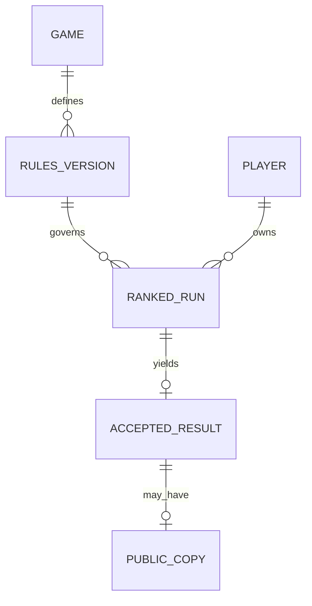

# Ranked submission and storage

[Design and architecture map](README.md) | [Event model](event-model.md)

The ranking server sends submissions to game-provided validation handlers and stores one accepted result per run. The [run lifecycle](event-model.md) explains the agreed issuance and retry behavior. This page describes submission processing and the relationships storage must preserve.

## Game rules and validation boundary

Each game defines what counts as a finish, how to measure a score, and which evidence its validation handler needs. That handler interprets the evidence and returns validated scores or a rejection. The ranking server routes the submission to the handler registered for the run's rules version, then stores accepted results and returns the outcome. The platform checks the caller's identity and run eligibility without interpreting the game's evidence.

For a completed guest attempt, the browser submits the temporarily retained run evidence under the account the player creates or connects. The result is attributed to that account and becomes eligible for ranking after successful validation.

## Validation pipeline

[ADR-0023](../decisions/0023-authenticate-ranked-requests-with-at-tokens.md)

The API authenticates the player using an AT service token and checks ownership of the issued run. It uses the server's recorded issuance time and game configuration when sending evidence to the game's validation handler. The game owns the evidence format and determines whether it supports the submitted score.

If the handler accepts a valid run, the platform records at most one accepted result. Concurrent equivalent submissions resolve to that result, and an equivalent retry returns it. An invalid run is rejected and is not retained after submission. An unavailable handler or store is a service failure, not a validation rejection.

An older game version remains eligible for new ranked submissions for 24 hours after its replacement is published. Valid historical results remain eligible unless revoked.

## Run and result storage

[ADR-0015](../decisions/0015-multiple-scores-per-game.md)

The server records run context at issuance and retains accepted results. Invalid runs are not retained after submission. Once associated with an account, a run belongs to that player and uses a particular game's rules. It can have at most one accepted result; a public copy is separate from that ranking authority.

The diagram shows runs associated with player accounts. Guest evidence is held temporarily in the browser before authenticated submission.

The rules assigned at issuance determine which handler evaluates the run and where its result can rank, even if the game is updated before submission. A result can contain several measures, each interpreted using the label and unit supplied by the game's rules.

The server must retain enough information to recognize an equivalent submission after acceptance. Each game defines the evidence its handler needs for validation and support.

The platform must support revoking invalid scores, including those affected by a game-breaking bug or cheating. Revoked scores no longer count in standings, and a submission retry must not restore their eligibility. Revocation preserves the one-result-per-run rule.

## Leaderboard queries

Each leaderboard includes one entry per player, using their best eligible accepted result within the board's scope and period. Results must match the board's rules version and comparison rule; revoked scores are excluded. A non-best attempt remains accepted even when it does not change the standings. A single-measure game can order by that measure's direction; games reporting several measures need an explicit choice of ranking rule and contextual values.

Leaderboard queries must support results around a specified player as well as the leading entries. This supplies the standings required by the [leaderboard flow](../player-flows/leaderboards.md#opening-and-switching-boards).

## Ranking API

The browser requests a run, submits the game's evidence, and reads the resulting standings through the ranking API. Responses must let it distinguish a final rejection from expired authorization or a temporary service failure.

A lost response supplies no outcome for the browser to interpret. Whether recovery needs a separate status operation and how the browser recovers confirmation remain open. [Recovery questions](../open-questions.md#ranked-submissions)

## Storage requirements

Storage must preserve one accepted result per run under concurrent requests and retain committed outcomes through restarts. Enforcing one accepted result must be atomic. Revocation must also survive restarts and deployments so invalid scores do not return to the standings.
