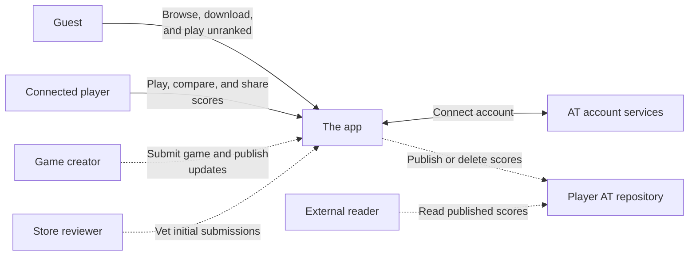
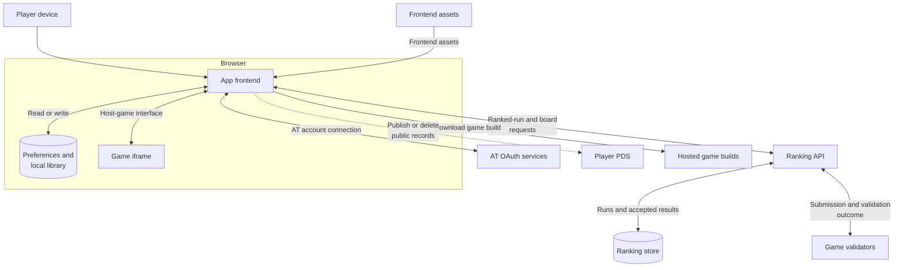
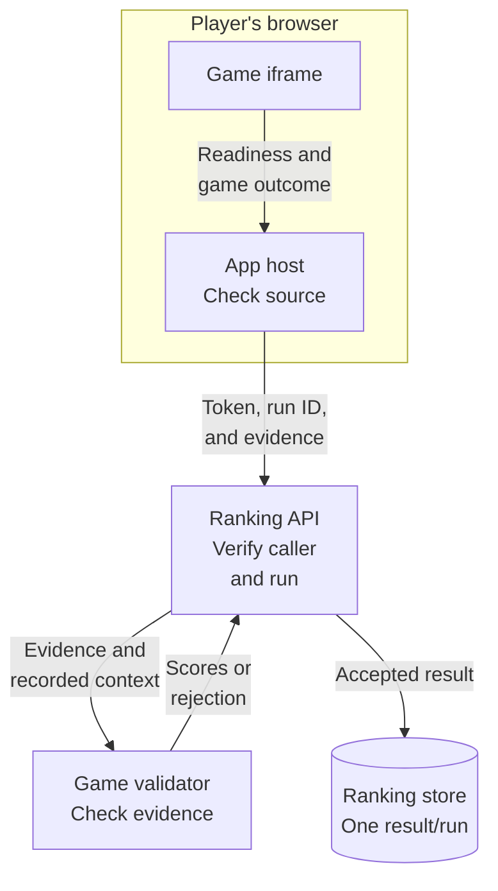
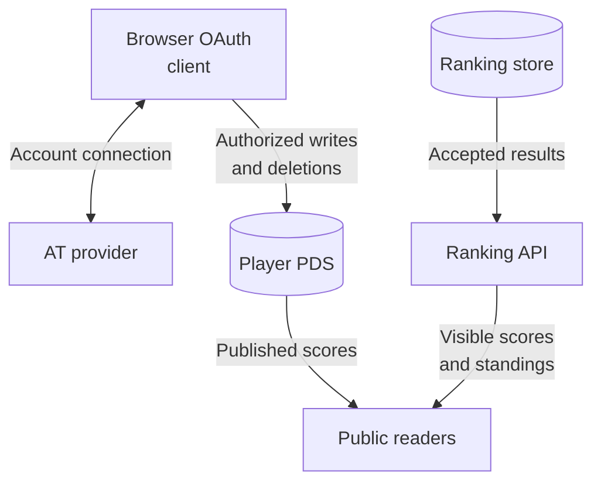

# System structure

[Design and architecture map](README.md) | [Deployment](deployment.md)

The app uses game results for standings and score exchanges between players. The ranking server maintains the official results, while players control which eligible scores they send to friends or publish publicly.

Games supply their own mechanics and validation handlers. Their playable interface runs in an iframe and reports outcomes through an interface provided by the frontend. For ranked play, the platform passes submitted evidence to the game's handler, which decides whether it supports the claimed result. The ranking server stores accepted results and returns the outcome to the player. Invalid runs are rejected and not retained after submission. The evidence format and the logic that checks it belong to the game.

The diagrams describe the responsibilities and data exchanges in the agreed design.

## System context

Solid lines show play and account interactions. Dashed lines show Store publishing and public score records. External readers see records published to the player's repository; the official standings are maintained by the ranking server.

## Components and data flows

[ADR-0017](../decisions/0017-iframe-game-runtime.md) [ADR-0003](../decisions/0003-server-validated-rankings.md) [ADR-0032](../decisions/0032-host-published-game-builds.md)

The browser loads the site and downloads published game builds from infrastructure we control, then calls the ranking API during ranked play. The API routes submissions to the appropriate game handler and writes accepted results to durable storage so standings remain available after a server restart.

The local Library is available to guests and connected players. It records games added on this browser independently of downloaded builds. The game host is part of the app frontend. It loads the game into an isolated iframe and communicates with it through the host-game interface.

## Browser components

The app frontend manages navigation and local Library membership. Its game host loads a game build into an isolated iframe, supplies the permitted dependencies, and handles communication for that launch. The host manages downloaded builds separately from Library entries, including replacement and offline availability. The [runtime and installation design](game-library.md) defines those responsibilities in detail.

The game iframe handles gameplay input and rendering. It reports outcomes and evidence through the host interface. For ranked play, the host requests run context from the ranking API and submits the evidence reported by the game. Guest evidence stays in temporary browser state through account connection so that the same attempt can be submitted afterward.

The browser's OAuth client holds AT credentials outside the game frame. The frontend uses the server's response to distinguish an accepted ranked result from a game-reported score. The [run lifecycle](event-model.md) describes that exchange, and the [result flow](../player-flows/play-and-results.md#reading-the-result) covers its presentation.

## Server responsibilities

The ranking API authenticates the player and uses the server's recorded run context when calling the game's handler. The handler evaluates the evidence under the rules assigned at issuance. The platform stores accepted results and uses them for standings; invalid runs are rejected and are not retained after submission.

Equivalent retries return the accepted result, including when requests arrive concurrently. This behavior requires the platform to enforce one accepted result per run.

## Trust boundaries

Each receiver checks the data it relies on. The host checks which game launch sent a message, the ranking API verifies the caller and run context, and the game's handler evaluates gameplay evidence. A score reported by the browser becomes an official result only after those checks succeed.

The host associates messages with the current frame and launch. Game code receives only the capabilities supplied through that interface; AT credentials remain outside the frame.

The ranking API verifies the AT service token and checks run ownership and eligibility using its stored issuance record. It selects the handler registered for that run's rules version. The game defines the evidence format and the checks for invalid play or cheating. The API distinguishes the handler's rejection from a failure to complete validation, and enforces at most one accepted result per run when writing to storage.

AT account access crosses a separate boundary. The browser's OAuth client authorizes access to the player's repository, while the ranking API verifies identity for ranked requests.

Account operations must use the intended provider and account, with the required write authorization and record shape. Publication writes a public copy of an accepted result; the repository's signature identifies its publisher, not whether the ranking server accepted the score. The [identity and sharing design](identity-and-sharing.md) describes that distinction and ownership checks for writes and deletions.

Public responses include the permitted player information, score measures, comparison rules, and rank. Gameplay evidence and credentials stay private, including when the result is published to AT Protocol.
