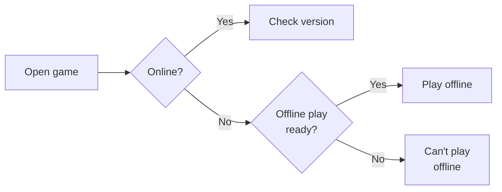
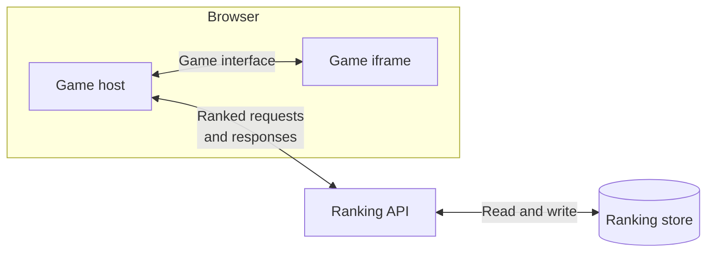
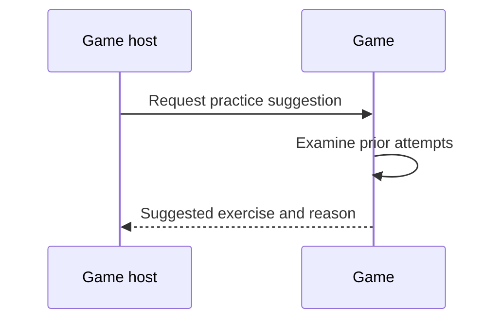
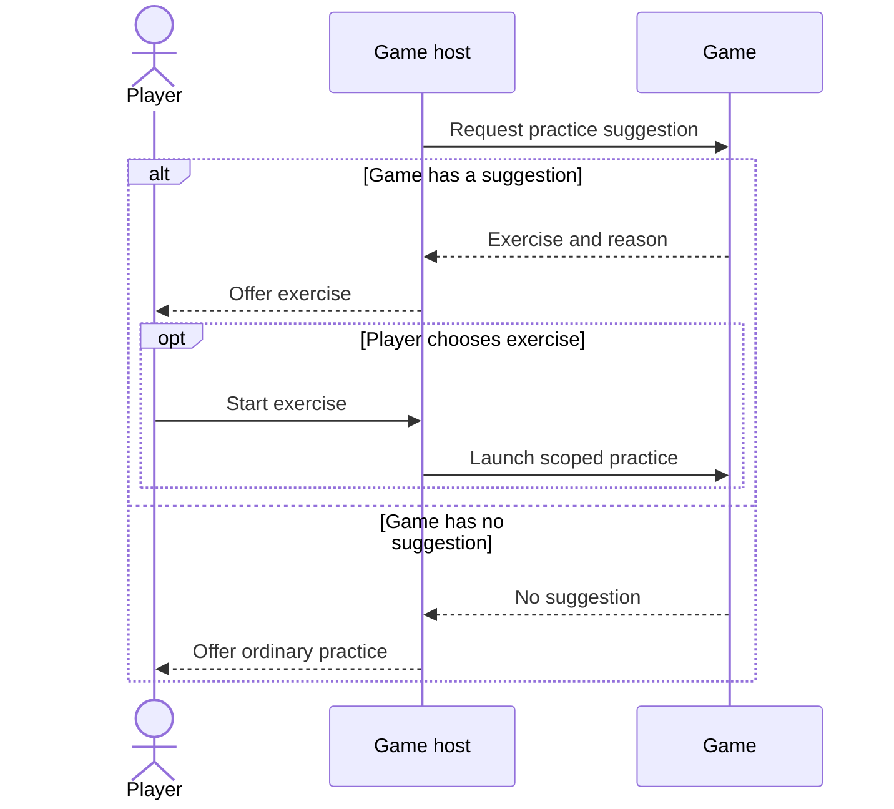
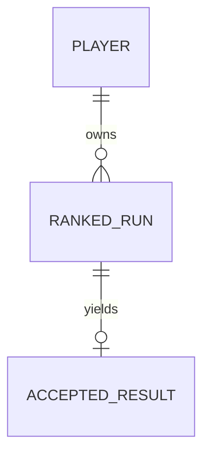
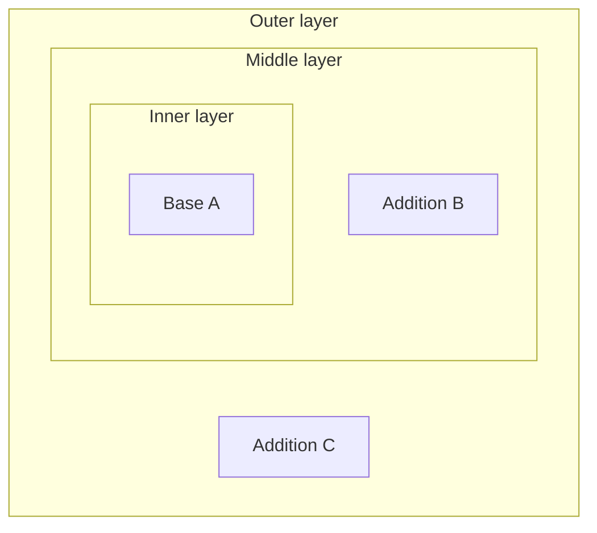

# Reading the diagrams

These examples show how to read the shapes, arrows, and labels used in the documentation.

## Flowcharts

Follow the arrows. Boxes represent actions or components; diamonds mark decisions. Arrow labels identify the branch to follow.

Cylinders represent storage. Enclosing boxes group components. A two-way arrow indicates an exchange in both directions.

Dashed connections take their meaning from their labels or the accompanying text.

## Sequence diagrams

Read downward through the messages between participants. Solid arrows send messages; dashed arrows return responses in these diagrams. A self-directed arrow shows internal work.

**alt** selects between alternatives; **else** marks another branch. **opt** runs its enclosed steps only when its condition holds. Nested frames apply within the surrounding branch.

Here, "optional" describes whether the player takes that path, not whether the behavior needs implementing.

## Entity relationships

Boxes represent record types. Read each connection in both directions. End markers give the count: `||` means exactly one, `o|` means zero or one, and `o{` means zero or more.

A player can own many runs or none. Each run belongs to one player and can yield at most one accepted result. Each accepted result belongs to exactly one run.

## Nested layer diagrams

Enclosing outlines show containment. Each outer layer includes the contents of the layers inside it, together with anything added at its own level.

The middle layer includes A and B. The outer layer includes A, B, and C. Nesting shows inclusion, not a sequence of steps.
