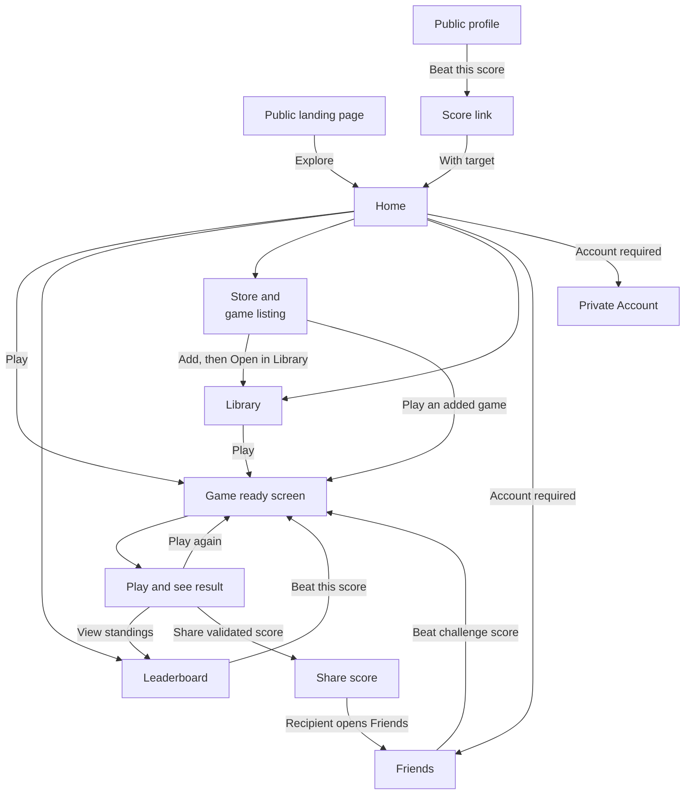

# Player flows

[Design and architecture](../architecture/README.md)

Players come to the site to compare scores, share results, or find out how they perform at a game. Their next goal might be a place on a weekly board, a friend's score, or their own personal best. These walkthroughs describe what players see and can do as they pursue those goals.

Each flow contains its user stories and the reasoning from the design discussion. The [user stories catalogue](../user-stories.md) collects them in one place. Story IDs are stable across the documents. The flows describe agreed product behavior. Frontend design determines the layout and controls used to support it.

## Comparing and sharing scores

The [leaderboard flow](leaderboards.md) follows a player looking for a score to beat across all-time, weekly, and Friends standings. Players can also send a score directly to someone they know. The [Friends flow](friends.md) describes accepting a friend request and finding and acting on scores received from that person.

For comparison with earlier attempts, [Account and public profiles](account.md) covers personal progress and the achievements a player makes public. It also explains how players control publication and keep milestones while deleting older AT records.

## Arrival and play

The route into those comparisons depends on whether the player arrives with a score to beat or needs a game to try.

[Landing page and Home](arrival-and-home.md) describes how a visitor sees the opportunity to compare scores and try a game, including arrival through a score link. It also covers returning to a familiar game or finding a new one. [Playing a round and using its result](play-and-results.md) follows an attempt into comparison, replay, practice, or sharing.

## Finding and managing games

Players use [the Store](store.md) to find games that interest them and inspect a listing before adding one. Added games appear in [the Library](library.md), where players can organize them for later visits.

Before a game reaches the Store, its creator submits a build and listing for review. [Submitting and updating games](publishing-games.md) describes that review and how creators publish later builds. Once people have played, [player reviews](reviews.md) let them recommend the game and revise their opinion after an update.

## Navigation across flows

This map follows guests and connected players through the app. Home, Store browsing, and the local Library are available to guests. Guest play is limited to games that do not require an account and produces unranked scores. Ranking and social features require account connection.

Game readiness, active play, and the result are combined here; the round walkthrough describes their requirements. A selected score remains the target through replay until beaten. Sharing includes the recipient choice and optional challenge flag.

## Interaction requirements

Across these flows, the app's primary path must be reachable by keyboard, with specialized game controls described before play. Navigation needs to move focus into the game or result appropriately and announce meaningful validation or error changes. These requirements should be checked in the app as well as in design review.

The [open-question backlog](../open-questions.md) collects unresolved architecture and tooling decisions. The [playtest plan](../research/player-playtests.md) proposes ways to test the flows with players.
