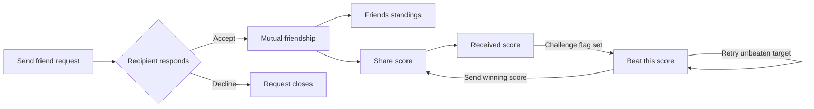

# Friends and received scores

[Player flows](README.md)

Friends gives players a smaller group to compete with and a place to return to scores sent by people they know. A received score may interest the player now or later. Keeping it under its sender lets the player find it by the person they remember, without requiring a live conversation or a separate match session.

A friend request establishes the mutual relationship used by Friends standings and direct score sharing. Once connected, either player can begin an exchange and continue it through later attempts.

## Establishing a friendship

> **S13** As a player who started looking for a friend as a guest and has now signed in, I want to continue that search without starting over.

> **S37** As a player who knows someone I want to compete with, I want to find them on RanKing so we can compare scores.

> **S38** As a player approached by someone who wants to be friends, I want to know who they are and decide whether we become friends.

A guest who reaches an account-dependent social action gets a way to connect and return to that task. The mockup review specifically asked to keep this prompt, rather than leaving guest players at an unusable account feature.

**Add friend** lets a connected player find someone by handle. The display name and handle identify the intended person before the request is sent. A sent request remains pending until the recipient responds.

The recipient can accept or decline. Acceptance establishes a mutual friendship, adds each person to the other's Friends list, and includes their eligible scores in each other's Friends leaderboard. Declining closes the request. Requiring acceptance gives both people a say in whether they appear as friends.

The mockup review requested Friends in place of Following. One-way following would let a player assemble a comparison group immediately, but would represent only that player's interest in the other person. Mutual friendship requires waiting for acceptance before the person joins the Friends comparison.

## Finding and acting on a shared score

[ADR-0014](../decisions/0014-score-sharing-and-challenges.md)

> **S23** As a player who received a score from a friend, I want to find that score when I'm ready to try beating it.

Opening a friend's entry shows scores they sent, including the game, score, and when it was set. A share with its challenge flag set offers **Beat this score**. An ordinary share displays the score without that action.

Choosing that action carries the result into play as a target. The player can retry against it until they beat it. If they return later, the shared score is still found under the sender. After a validated winning result, **Send score back** uses the same share action with the sender selected.

A score battle is an ongoing exchange in which friends try to beat each other's scores. Friends can agree on their own endpoint and use score dates and times to judge it. The app does not need a second challenge workflow to support the same exchange, and the received-score view does not introduce general chat.
