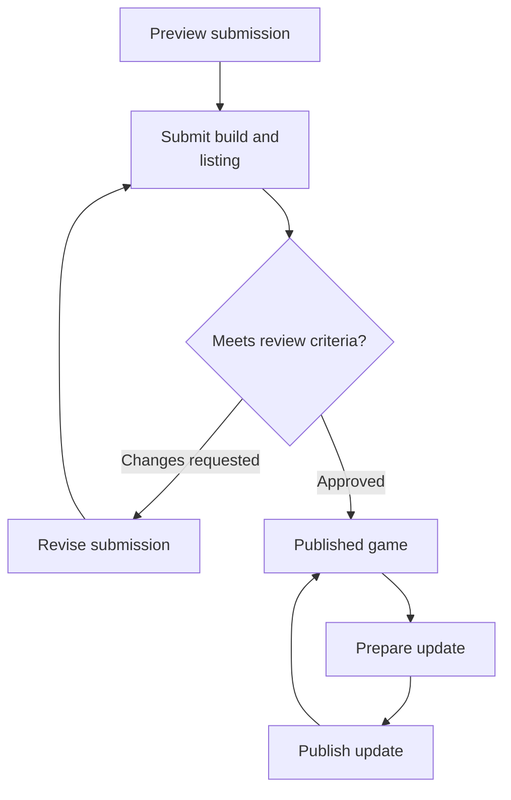

# Submitting and updating Store games

[Player flows](README.md)

This flow covers how a creator gets a game into the Store and delivers updates to players who have added it. Initial human review checks that the game represents reasonable effort and that its listing describes the playable build accurately. Subsequent updates go through by default, so creators can ship fixes when moderators are unavailable. Reports or automatic flags can trigger further human review.

Admission and later updates both produce a published build. Requested changes return to the initial submission, while an admitted creator can publish updates without waiting for another admission review.

## Store admission

### Preparing a submission

> **S43** As a game creator preparing a release, I want to know that my listing is accurate and my game works on RanKing.

The creator prepares a playable build and its Store listing, previews the listing, and launches that exact build through the iframe host. Testing in the host matters because a game that runs on its own may still fail when launched with the app's dependencies and isolation.

The creator submits the build and listing together. The review needs a stable reference to both so that feedback applies to the version the reviewer actually tried. We retain and distribute published builds, so creators do not need to host downloads themselves. [ADR-0032](../decisions/0032-host-published-game-builds.md)

### Reviewing reasonable effort

[ADR-0022](../decisions/0022-store-submission-and-automatic-updates.md)

> **S44** As a reviewer, I want to determine whether a submitted game works as advertised and meets the Store's admission standards.

The reviewer tries the main play flow and compares it with the listing. They check that a player can understand the objective, use the advertised controls and modes, and receive feedback from play. A small game with one complete interaction can meet this standard; the review is not a requirement to ship a large game.

The listing must describe that build accurately. For example, a listing that promises keyboard-only play needs a main flow that can actually be entered and played with a keyboard. A claim of official ranked support also requires a registered validator for the applicable rules.

Approval admits the reviewed build and listing to the catalog. It does not substitute for player recommendations about enjoyment or difficulty. Those judgments appear through the [review system](reviews.md).

### Requesting changes

> **S45** As a game creator asked to make changes, I want to understand what needs fixing so I can get my game ready for publication.

If the submission needs work, the reviewer records what they encountered and what would resolve it. **Changes requested** keeps that feedback attached to the submission so the creator can revise the build or correct the listing and resubmit in the same place.

The reviewer must be able to identify what changed on resubmission. This avoids treating each revision as an unrelated submission and gives the creator a clear route from feedback to approval.

## Publishing an update

[ADR-0022](../decisions/0022-store-submission-and-automatic-updates.md)

> **S46** As a game creator, I want to get fixes and improvements to players promptly.

After admission, the creator can publish a new build, changelog, and listing edits. A new build gets its own version rather than replacing the contents of an existing published version. A checkbox lets the author mark the update as critical. Requiring another human review for every build would make routine fixes and security patches depend on moderator availability.

An update that changes ranked rules needs the validator for those rules before the affected mode can support official ranked play. A build change does not itself imply a scoring change: a visual fix can preserve the rules under which earlier results remain comparable.

### Receiving updates

[ADR-0028](../decisions/0028-update-games-on-online-open.md)

> **S47** As a player returning to a game that has been updated, I want to play the improved version.

When a player opens the game online, the app checks for updates. Critical updates must be installed before online play; non-critical updates can be deferred so a player on a slow or limited connection can use the installed version. When an update proceeds, the app handles installation. The author supplies the critical-update classification when publishing.

If the update check fails or the player is offline, an offline-capable game can use its installed copy without ranking or other online features. The next online open checks for updates again. The same Library entry and score history continue across versions. An older version remains eligible for new ranked submissions for 24 hours after its replacement is published. Valid historical scores remain; scores made invalid by a game-breaking bug can be revoked.

Background downloads and prefetching are optional and enabled by default. The [installation design](../architecture/game-library.md#install-and-update-lifecycle) preserves an existing installation during a partial download.

## Reviewing reports and flags

A report or automatic flag can bring the game or update to human review. The reviewer investigates that concern rather than routinely reviewing every republished build. Republication proceeds by default.
